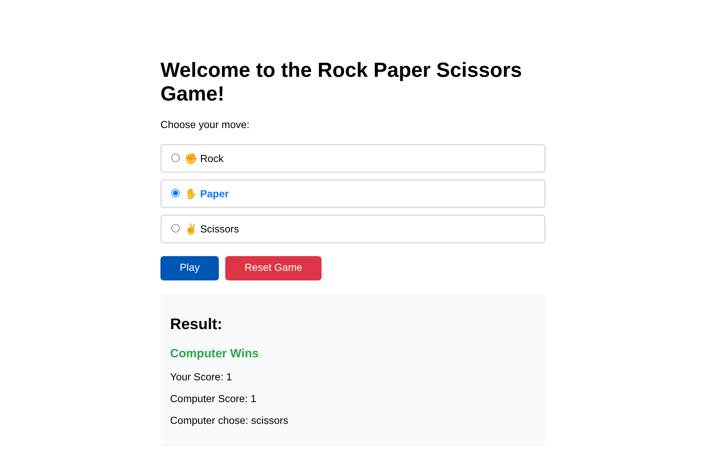

# 🎮 Django Rock Paper Scissors


> **Rock Paper Scissors against the computer: a Django backend with a small JSON API, session-based score keeping and a fetch-driven frontend without page reloads.**



## ✨ Features

- 🎯 **Play against the computer** – choose Rock, Paper or Scissors
- 📊 **Score tracking per visitor** – scores live in the Django session, not in a global variable
- ⚡ **No page reload** – the frontend talks to the backend with `fetch` and JSON
- 🔒 **CSRF protected** – every POST sends the Django CSRF token
- 🔄 **Reset** – start a new match with one click

## 🛠️ Tech Stack

- **Django 5.1** – views, sessions, templates
- **Vanilla JavaScript** – `fetch` API, DOM updates
- **SQLite** – session storage (Django default)

## 🔌 Endpoints

| Method | Path | Purpose |
|--------|------|---------|
| GET | `/` | Game page |
| POST | `/game/` | Play one round. Body: `{"userChoice": "rock" \| "paper" \| "scissors"}` |
| POST | `/reset/` | Reset both scores to 0 |

Example response of `/game/`:

```json
{ "result": "You Win", "user": 1, "computer": 0, "computerChoice": "scissors" }
```

## ▶️ Run Locally

```bash
git clone https://github.com/Martin-Frei/Django_rspGame.git
cd Django_rspGame
python -m venv venv
source venv/bin/activate        # Windows: venv\Scripts\activate
pip install -r requirements.txt
python manage.py migrate
python manage.py runserver
```

Then open <http://127.0.0.1:8000/>.

## ⚙️ Configuration

The project runs locally without any configuration. For a deployment, set these environment variables:

| Variable | Default | Purpose |
|----------|---------|---------|
| `DJANGO_SECRET_KEY` | insecure development key | Secret key – **must** be set in production |
| `DJANGO_DEBUG` | `True` | Set to `False` in production |
| `DJANGO_ALLOWED_HOSTS` | empty | Comma-separated host names, e.g. `example.com,www.example.com` |

## 📂 Project Structure

```
Django_rspGame/
├── game/               # App: views with the game logic
├── rspGame/            # Project: settings, urls
├── template/
│   └── index.html      # Game page (HTML, CSS, JavaScript)
├── screenshots/
├── manage.py
└── requirements.txt
```

## 🎓 What I Learned

- Building a small JSON API with Django function views
- Keeping state per user with sessions instead of global variables
- Sending CSRF-protected `fetch` requests from JavaScript
- Validating user input on the server

## 👨‍💻 Author

**Martin Freimuth**
- GitHub: [@Martin-Frei](https://github.com/Martin-Frei)
- LinkedIn: [martin-freimuth](https://www.linkedin.com/in/martin-freimuth-089249359/)
